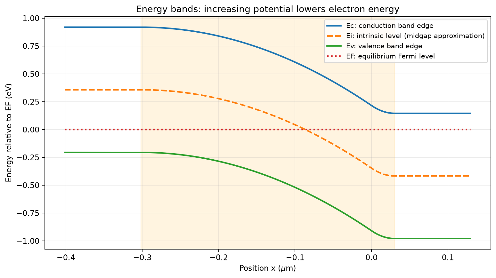
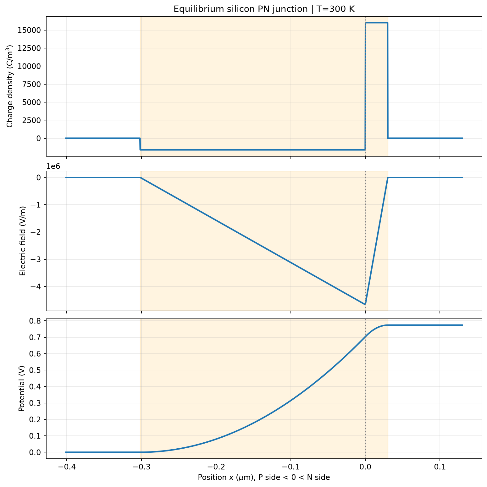
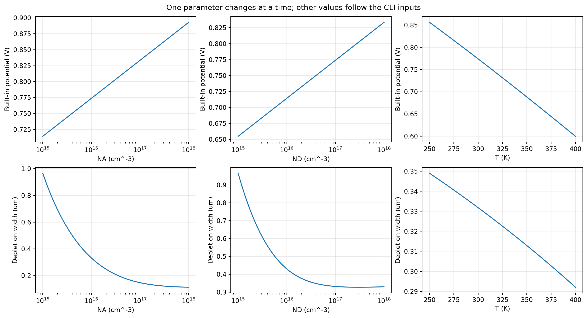
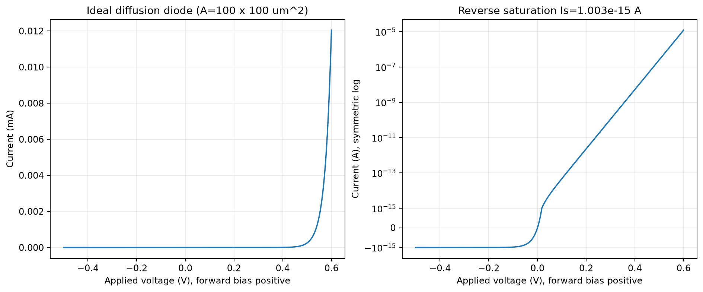
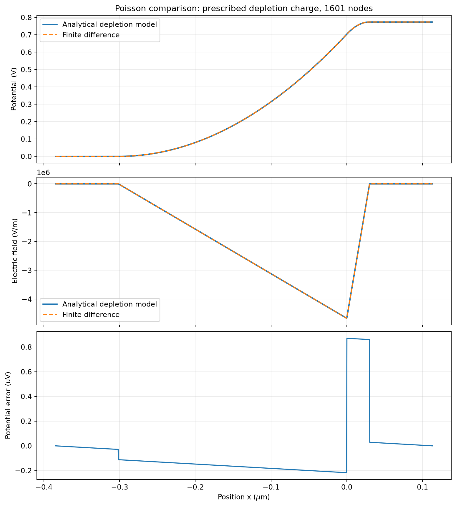
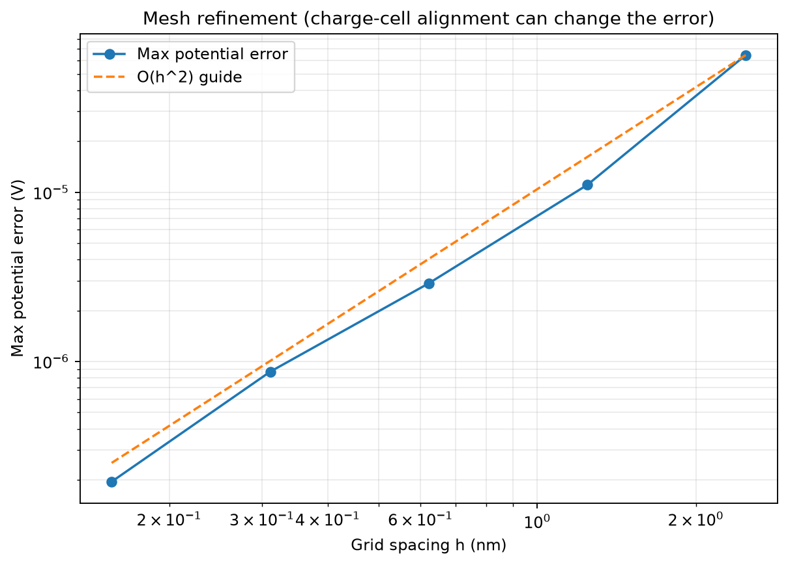

# mini-tcad-pn

从静电势到能带，再到数值解：一个可以直接运行的一维硅结教学项目。

**TCAD（Technology Computer-Aided Design，工艺与器件计算机辅助设计）**用物理模型和数值计算研究半导体器件；本项目用它的静电学部分帮助你理解器件。**PN Junction（P-type–N-type Junction，P 型与 N 型半导体形成的结，简称 PN 结）**是这里的研究对象，用来学习整流器件的基础物理。

本项目先采用 **depletion approximation（耗尽近似）**：在结附近忽略可移动的电子、空穴，只保留电离杂质电荷；结外视为电中性。这个近似把电荷分布简化成分段常数，方便得到解析解。随后求解 **Poisson equation（泊松方程）**，即描述电荷密度与电势曲率关系的方程，用来把同一电荷模型转成数值电势，并检查解析解和数值解的一致性。

模型包含内建电势、耗尽层宽度、空间电荷密度、电场、电势、能带、参数扫描及理想二极管 **I–V（Current–Voltage，电流—电压）**特性。它适合入门、课程展示和作为 GitHub 学习项目，模型边界见下文。



## 直接运行

需要 Python 3.10 或更新版本。在终端执行：

```bash
git clone https://github.com/carveself/mini-tcad-pn.git
cd mini-tcad-pn
python -m venv .venv
```

激活虚拟环境：

```bash
# macOS / Linux
source .venv/bin/activate
# Windows PowerShell（使用这一行代替上一行）
# .venv\Scripts\Activate.ps1
```

安装依赖并一键生成所有图像和数据：

```bash
python -m pip install -r requirements.txt
python run_all.py
python -m unittest discover -s tests -v
```

图像自动保存到项目的 `figures/`，不需要弹出绘图窗口。仓库中已经包含默认参数的完整结果；再次运行会覆盖同名文件。

也可以分别运行：

```bash
python src/pn_junction.py
python src/parameter_sweep.py
python src/poisson_numeric.py
```

改变掺杂、温度和输出目录：

```bash
python run_all.py --na 2e16 --nd 5e16 --temperature 320 --output figures/custom
python src/poisson_numeric.py --nodes 3201 --output figures/fine_grid
python src/pn_junction.py --help
```

`--na`、`--nd` 的单位为 cm⁻³，`--temperature` 为 K；`--nodes` 仅适用于 `poisson_numeric.py`。`--output` 的相对路径相对于运行命令时的目录；省略时总是保存到项目自身的 `figures/`。`run_all.py` 支持三个脚本共有的参数。

## 项目结构

```text
mini-tcad-pn/
├── README.md
├── requirements.txt
├── run_all.py                 # 顺序执行三个演示，出错时停止
├── .gitignore
├── src/
│   ├── pn_junction.py         # 解析静电学、能带与理想 I–V
│   ├── parameter_sweep.py     # 分别扫描 NA、ND、T
│   └── poisson_numeric.py     # 有限差分、误差、网格收敛
├── tests/
│   └── test_physics.py        # 物理约束与独立方程算例
└── figures/                  # 自动生成的 PNG、CSV、JSON
```

## 先读懂符号与单位

| 符号 | 英文与中文含义 | 在项目中的作用 |
| --- | --- | --- |
| $N_A$ | Acceptor concentration，受主浓度 | 设置 P 区掺杂，决定负空间电荷 |
| $N_D$ | Donor concentration，施主浓度 | 设置 N 区掺杂，决定正空间电荷 |
| $n_i$ | Intrinsic carrier concentration，本征载流子浓度 | 计算内建电势与反向饱和电流 |
| $V_T=k_BT/q$ | Thermal voltage，热电压 | 把温度转成电压尺度 |
| $V_{bi}$ | Built-in potential，内建电势 | 平衡时结内的势垒高度 |
| $x_p,x_n,W$ | Depletion widths，耗尽区宽度 | P 侧、N 侧及总耗尽宽度 |
| $\rho$ | Space charge density，空间电荷密度 | 泊松方程的电荷源项 |
| $\mathcal E$ | Electric field，电场 | 由电势的负梯度得到 |
| $\psi$ | Electrostatic potential，静电势 | 连接电荷、电场与能带 |

内部统一采用 **SI（International System of Units，国际单位制）**：长度 m、掺杂 m⁻³、电荷 C、电场 V/m、电势 V。输入的 cm⁻³ 要乘 $10^6$ 才是 m⁻³；图中位置转成 μm。能量单独使用 **eV（electron volt，电子伏特）**，用于画半导体能带。把 V/m 转成 V/cm 应除以 100。

## 解析模型：从电荷到电势

取结面 $x=0$，左侧为 P 区，右侧为 N 区；正方向从 P 指向 N。$q$ 为正的元电荷，$k_B$ 为玻尔兹曼常数，$\varepsilon_{Si}=11.7\varepsilon_0$ 为硅介电常数。

非简并、完全电离条件下：

$$
V_{bi}=V_T\ln\left(\frac{N_AN_D}{n_i^2}\right),\qquad
W=\sqrt{\frac{2\varepsilon_{Si}V_{bi}}{q}\left(\frac{1}{N_A}+\frac{1}{N_D}\right)}
$$

$$
x_p=\frac{N_D}{N_A+N_D}W,\qquad
x_n=\frac{N_A}{N_A+N_D}W,\qquad N_Ax_p=N_Dx_n
$$

最后一个等式表示正负耗尽电荷相等，因此耗尽区主要伸入掺杂较轻的一侧。耗尽电荷为：

$$
\rho(x)=\begin{cases}
-qN_A,&-x_p<x<0,\\
+qN_D,&0<x<x_n,\\
0,&\text{其他位置}.
\end{cases}
$$

通过 $d\mathcal E/dx=\rho/\varepsilon_{Si}$ 和 $\mathcal E=-d\psi/dx$ 得到：

$$
\mathcal E(x)=\begin{cases}
-qN_A(x+x_p)/\varepsilon_{Si},&-x_p\le x<0,\\
qN_D(x-x_n)/\varepsilon_{Si},&0\le x\le x_n,\\
0,&\text{其他位置}.
\end{cases}
$$

$$
\psi(x)=\begin{cases}
0,&x<-x_p,\\
qN_A(x+x_p)^2/(2\varepsilon_{Si}),&-x_p\le x<0,\\
V_{bi}-qN_D(x_n-x)^2/(2\varepsilon_{Si}),&0\le x\le x_n,\\
V_{bi},&x>x_n.
\end{cases}
$$

所以电场在耗尽区内为负，方向是从 N 到 P；电势从 P 到 N 升高。内建电势是器件内部的势差，平衡时直接在外部端子接电压表不能把它当成电池电压读取。[NPTEL 的 PN 结课程](https://archive.nptel.ac.in/content/storage2/courses/117102061/pn/PN_1.htm)给出了平衡、耗尽近似和接触电势的物理推导。



默认 $N_A=10^{16}$ cm⁻³、$N_D=10^{17}$ cm⁻³、$T=300$ K：

| 量 | 本项目计算结果 |
| --- | ---: |
| $n_i$ | $1.00\times10^{10}$ cm⁻³ |
| $V_{bi}$ | 0.773844 V |
| $W$ | 0.331780 μm |
| $x_p$ | 0.301618 μm |
| $x_n$ | 0.0301618 μm |
| 最大电场绝对值 | $4.66480\times10^6$ V/m |

## 能带：为什么电势升高，能量下降？

**Energy band diagram（能带图）**用于观察电子的能量分布。**Conduction band edge（导带底，$E_C$）**和 **Valence band edge（价带顶，$E_V$）**之间的间隔是 **Band gap energy（禁带宽度，$E_g$）**；**Intrinsic energy level（本征能级，$E_i$）**用于连接载流子浓度和能量；**Fermi level（费米能级，$E_F$）**在热平衡中必须处处相同。

这里选择能量参考点 $E_F=0$ eV，并近似把 $E_i$ 放在禁带中央：

$$
E_{i,p}=V_T\ln(N_A/n_i),\quad E_i(x)=E_{i,p}-\psi(x),\quad
E_C=E_i+E_g/2,\quad E_V=E_i-E_g/2.
$$

以上能量以 eV 表示，所以电势的数值可以直接相减。其物理原因是电子带负电，势能为 $-q\psi$。P 到 N 的电势升高，能带就下降；$E_F$ 保持水平。[Stanford EE116 的课程讲义](https://poplab.stanford.edu/files/ee116/L18toL21_PNjunction.pdf)可帮助把电荷、电场和势垒图联系起来。

## 温度与参数扫描

硅的 $n_i$ 对温度非常敏感，因此不能只改变 $V_T$ 而把 $n_i$ 固定。项目使用以下教学近似：

$$
E_g(T)=1.17-\frac{4.73\times10^{-4}T^2}{T+636}\quad\mathrm{eV}
$$

$$
n_i(T)=n_i(300)\left(\frac{T}{300}\right)^{3/2}
\exp\left[\frac{E_g(300)}{2k_{B,eV}300}-\frac{E_g(T)}{2k_{B,eV}T}\right].
$$

这里 $k_{B,eV}=k_B/q$ 的单位为 eV/K，$n_i(300)=10^{10}$ cm⁻³ 是选定的标定值。不同教材和测量拟合可能采用不同标定；本项目的数值不应视为硅材料的精密测量结果。关于浓度随温度变化的物理背景，可读 [PVEducation 的本征载流子浓度说明](https://www.pveducation.org/pvcdrom/pn-junctions/intrinsic-carrier-concentration)。

`parameter_sweep.py` 对 $N_A$、$N_D$ 各扫描 41 个对数等距点（$10^{15}$–$10^{18}$ cm⁻³），对温度扫描 41 个点（250–400 K），共 123 个算例。每组只改变一个参数，其他参数使用命令行给定的基准值；另外比较 250、300、400 K 的能带和理想 I–V。



可以先观察：增加一侧掺杂会使 $V_{bi}$ 增大、$W$ 减小；固定掺杂下温度升高会使 $n_i$ 快速增大，通常使 $V_{bi}$ 下降。

## 理想二极管 I–V

采用 **Shockley diode equation（肖克利二极管方程）**描述理想扩散电流：

$$
I(V)=I_S\left[\exp(V/V_T)-1\right],\qquad
I_S=qA n_i^2\left(\frac{D_n}{L_nN_A}+\frac{D_p}{L_pN_D}\right).
$$

**Diffusion coefficient（扩散系数，$D$）**描述载流子因浓度差而扩散的能力；这里通过 **Einstein relation（爱因斯坦关系）** $D=\mu V_T$ 把它与 **Mobility（迁移率，$\mu$）**联系起来。**Minority-carrier lifetime（少数载流子寿命，$\tau$）**表示少数载流子复合的典型时间，**Diffusion length（扩散长度，$L=\sqrt{D\tau}$）**设置扩散电流的长度尺度。

取面积 $A=10^{-8}$ m²（100 μm × 100 μm）、电子迁移率 1350 cm²/(V·s)、空穴迁移率 480 cm²/(V·s)，两种少数载流子寿命均为 1 μs。$I_S$ 是 **Reverse saturation current（反向饱和电流）**，不是任意调出的曲线系数；默认值见 `figures/junction_summary.json`。正电压代表正向偏置，负电压时理想电流趋近 $-I_S$。



这张图来自长基区、低注入的独立解析电流模型。迁移率和寿命固定，不包含掺杂依赖、串联电阻、击穿或耗尽区复合；较大正向电流处会偏离真实器件。静电学和能带图始终为零偏压平衡状态，I–V 不是偏压下自洽求解的结果。

## 数值解：独立求解泊松方程

**Finite Difference Method（有限差分法，FDM）**用相邻网格点的差分近似导数，将微分方程转成线性方程组。本项目对

$$
\frac{d^2\psi}{dx^2}=-\frac{\rho}{\varepsilon_{Si}}
$$

使用均匀网格，得到

$$
-\psi_{i-1}+2\psi_i-\psi_{i+1}=h^2\rho_i/\varepsilon_{Si}.
$$

**Dirichlet boundary condition（狄利克雷边界条件）**直接指定边界电势：左端为 0，右端为 $V_{bi}$。计算域为 $[-x_p-0.25W,\ x_n+0.25W]$，边界位于中性区内。三对角系统通过 **Thomas algorithm（托马斯算法，即三对角消元法）**求解，时间和内存开销都与网格点数成正比；代码没有把解析电势数组作为数值答案。

电荷采用每个节点控制区间内的平均值，按与 P、N 耗尽区的重叠长度计算。这样可避免在电荷突变位置随意取左值或右值，并保持离散总电荷接近零。解析解与数值解使用同一组已知耗尽边界和电荷模型，比较的是离散和求解误差。

默认 1601 点的实际验证结果：

| 指标 | 结果 |
| --- | ---: |
| 最大电势误差 | $8.71\times10^{-7}$ V（0.871 μV） |
| 电势均方根误差 | $2.50\times10^{-7}$ V |
| 最大电场误差 | $4.01\times10^3$ V/m（约峰值的 0.086%） |
| 归一化离散残差 | $1.48\times10^{-11}$ |

归一化离散残差是离散方程残差最大值除以电荷右端项最大值，用于确认线性方程被正确求解；它与相对解析解的误差是两种指标。数值电场由电势差分得到，在电荷边缘附近误差会更明显。



程序还比较 201、401、801、1601、3201 点。**Mesh convergence（网格收敛）**用于观察缩小网格间距 $h$ 后误差是否降低；图中给出 $O(h^2)$ 参考线。电荷跳变与网格的相对位置会影响误差系数，各步不一定严格按四倍下降。



这不是载流子自洽求解：耗尽边界来自解析公式，电荷预先给定。它没有求解移动载流子的连续性方程，也没有把泊松方程和输运方程耦合。未来可以在此基础上加入平衡玻尔兹曼载流子以及漂移—扩散方程。

## 输出与验证

| 文件 | 用途 |
| --- | --- |
| `electrostatics.png` / `equilibrium_profiles.csv` | 电荷、电场、电势与能带数据 |
| `energy_bands.png` | 平衡能带 |
| `ideal_iv.png` / `ideal_iv.csv` | 理想电流曲线与原始数据 |
| `parameter_sweep.png` / `parameter_sweep.csv` | 123 组扫描结果 |
| `temperature_bands_iv.png` | 温度对能带与理想 I–V 的影响 |
| `poisson_comparison.png` / `poisson_profiles.csv` | 解析解和有限差分解的对比 |
| `poisson_convergence.png` | 网格收敛 |
| `junction_summary.json` / `poisson_metrics.json` | 参数、误差与残差记录 |

CSV 的列名明确标出单位。7 个自动测试覆盖电荷中性、边界与能带、理想 I–V、参数趋势、对称及两种方向的非对称结，并使用独立构造的二次函数和正弦函数检验泊松求解器及二阶收敛。默认一键运行、123 组扫描和 7 个测试已在 Python 3.12、NumPy 2.3.5、Matplotlib 3.11.2 上通过。

## 模型适用范围

- 一维、均匀掺杂的硅突变同质结；热平衡静电学，杂质完全电离，介电常数固定。
- 输入限制：250–400 K、$10^{14}\le N_A,N_D\le10^{18}$ cm⁻³，并要求每侧掺杂至少为对应 $n_i(T)$ 的 100 倍。参数扫描采用的范围见上文；若自定义基准掺杂过低，400 K 的扫描可能不满足此条件并报错。
- 使用非简并统计与耗尽近似。高掺杂端仍有教学近似误差，不考虑简并、禁带变窄、量子效应和界面电荷；$E_i$ 放在禁带中间也只是近似。
- 温度模型经过室温标定，迁移率和寿命固定；结果适合学习趋势，不用于器件工艺签核。

推荐阅读顺序：先运行 `pn_junction.py` 看电势与能带，再看参数扫描，最后读 `poisson_numeric.py` 并运行测试。每一步都可以从保存的 CSV 和 JSON 中核对图像背后的数值。
